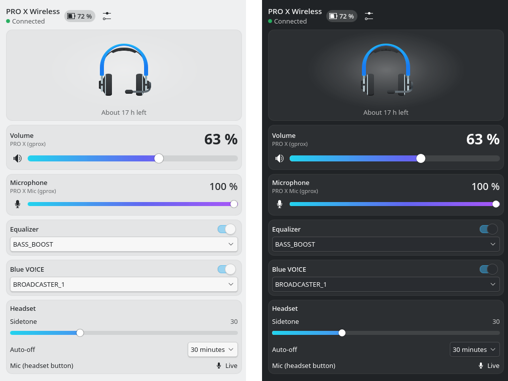

# Glinux Hub - GProX

G HUB's headphone EQ, Blue VO!CE mic chain and headset controls for the **Logitech G PRO X Wireless** on Linux.

Unofficial and not affiliated with Logitech. **No G HUB presets are included.** You can copy them from your own G HUB install
(see [Setup](#setup)), or use [gprox's own presets](#presets-without-g-hub), which work without G HUB.



## Features

- **Headphone EQ:** G HUB's 10-band and 2-band EQ.
- **Blue VO!CE:** the full mic chain (EQ, noise reduction, gate, de-esser, compressor, limiter) using the presets from your G HUB install
  or gprox's own.
- **Presets without G HUB:** three generic headphone EQ presets and three Blue VO!CE presets made for gprox.
- **Preset editing** in the GUI: change any setting live, save your own presets.
- **Headset controls:** sidetone (optionally always on), auto-off timer, battery level and mic mute state.
- **Import** of your own presets from G HUB.
- A KDE Plasma 6 tray widget, a small GUI and a command-line tool.

## Before you start

This is **not a plug-and-play app**. You need:

- The **G PRO X Wireless** with its USB dongle (`046d:0aba`). No other headset is supported.
- **Arch Linux or an Arch-based distribution** (CachyOS, EndeavourOS, …) with PipeWire and WirePlumber.
- Optional: **a Windows PC or virtual machine with G HUB installed**, to copy G HUB's presets and battery model from.
  Without it, everything works with [gprox's own presets](#presets-without-g-hub), but the battery shows in volts instead
  of percent.
- A few minutes in a terminal. Setup is done with commands.
- Optional: KDE Plasma 6 for the tray widget.

## Install

Download the package from the [latest release](https://github.com/Unackn0wledged/Glinux-Hub-GProX/releases/latest)
(the release notes list its SHA-256) and install it. pacman installs the dependencies:

```bash
curl -LO https://github.com/Unackn0wledged/Glinux-Hub-GProX/releases/download/v0.1.1/gprox-0.1.1-1-x86_64.pkg.tar.zst
```

```bash
sudo pacman -U gprox-0.1.1-1-x86_64.pkg.tar.zst
```

Or build it from source (needs `rustup`, `clang` and `pkgconf`): clone this repository, then run `makepkg -si` in
`packaging/aur`.

## Setup

1. **Start the service** (it starts by itself at every login after this):

   ```bash
   systemctl --user start gproxd
   ```

2. **Copy the G HUB files (optional).** On Windows, copy the folder `C:\ProgramData\LGHUB\depots\<number>\pro_headset` to this
   computer, then:

   ```bash
   gprox setup /path/to/pro_headset
   ```

   ```bash
   systemctl --user restart gproxd
   ```

   This also makes **PRO X (gprox)** and **PRO X Mic (gprox)** your default output and input. If you skip this step, pick
   them yourself in your sound settings and use [gprox's own presets](#presets-without-g-hub).

3. **Your own G HUB presets (optional).** With G HUB closed, copy `settings.db` and `settings.db-wal` from
   `%LOCALAPPDATA%\LGHUB\` into one folder, then:

   ```bash
   gprox import ghub /path/to/that-folder
   ```

4. **Tray widget (KDE).** Right-click the system tray → **Configure System Tray…** → **Entries** → **gprox Headset** →
   **Always shown**.

## Presets without G HUB

Not everyone has G HUB on a Windows virtual machine or an old Windows install to copy presets from. So gprox comes with
three generic presets for each chain, built into the programs and always listed first:

| Headphone EQ | |
|---|---|
| gprox Movies | Sub-bass and bass weight, clear dialogue, softer treble |
| gprox FPS | Low end tamed, footsteps and positional detail (1.5–5 kHz) lifted, top octave down for long sessions |
| gprox Music | Close to neutral with a slight warmth |

| Blue VO!CE (mic) | |
|---|---|
| gprox Natural | A clear, natural voice: light noise reduction, gentle compression |
| gprox Broadcast | A fuller streaming voice: warmer low-mids, firmer compression, de-esser |
| gprox Noisy Room | Strong noise reduction and a gate that follows the room's noise floor |

They are gprox's own settings, not copies of G HUB presets. The EQ presets only cut (no band above 0 dB), because the EQ
has no pre-gain and a boost would clip loud material at full volume. So they play a little quieter than `flat` (Music
about 1 dB, FPS about 3, Movies about 5). Turning Blue VO!CE on without a preset picks gprox Natural. To make your own
variant, edit one in `gprox-gui` and save it under a new name; the built-in presets themselves can't be changed.

The built-in presets and preset editing are on `main` and come with the next release. Until then, build from a clone:
`makepkg -si` in `packaging/arch`.

## Usage

Use the tray widget, `gprox-gui` (in the application menu), or the CLI:

```bash
gprox status
```

```bash
gprox preset list
```

```bash
gprox bluevoice set "gprox natural"
```

```bash
gprox sidetone 30
```

```bash
gprox preset save "my eq"
```

`gprox --help` lists the rest. In `gprox-gui`, edited presets show "(modified)"; **Save as…** stores them in
`~/.config/gprox/` as your own. G HUB's presets, `flat` and the built-in presets are read-only: save a copy under
another name.

Good to know:

- **Always-on sidetone:** the headset only plays sidetone while something records from its mic. The **Always on** switch
  (or `gprox sidetone always-on on`) keeps the mic stream open. KDE then shows its "microphone in use" icon all the time.
- **Mute state** is a best guess. The headset doesn't report it, so gprox counts button presses.
- Without the headset, **PRO X Mic (gprox)** records silence and **PRO X (gprox)** plays to your other output.
- Logs: `journalctl --user -u gproxd`. To turn gprox off: `systemctl --user mask --now gproxd`.

## How it was built

G HUB was studied in a Windows 11 virtual machine (never run on Linux). Each part was written up as a specification in our
own words, re-implemented from scratch in Rust, and tested against recordings of G HUB's own output.

Tools: **Ghidra** (static analysis of G HUB's audio processing objects), **Frida** (hooks in the Windows audio engine to record
parameters and audio), **Wireshark/usbmon** (USB traffic to the dongle), **QEMU/KVM with virt-manager**, **Python/NumPy**,
**Rust**, **Qt/QML** (tray widget) and **Claude Code** (AI assistance with the analysis and the code).

**Accuracy:** the headphone EQ is bit-exact with G HUB's output in our recordings. The Blue VO!CE chain differs from G HUB's
engine by −83 to −101 dB on 8 seconds of speech (three presets), and by −68 dB from one live G HUB recording.

Tests: `bash tools/ci.sh`. The comparisons with G HUB's output need recordings that are not distributed, so they skip here.

## License

GPL-3.0-or-later, see [LICENSE](LICENSE). Logitech, G HUB, PRO X and Blue VO!CE are trademarks of Logitech, used only to
describe what this software works with.
